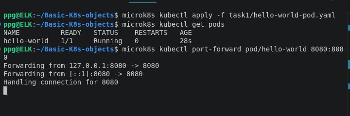
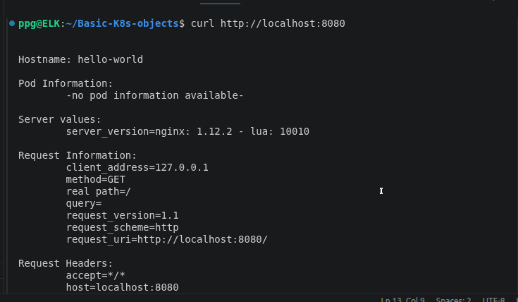
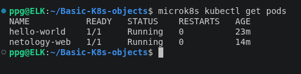
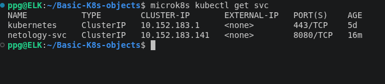
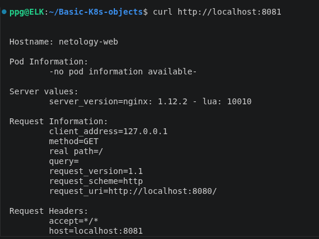

# Домашнее задание к занятию "Базовые объекты K8S"  - Петр Петров
Цель работы

Развернуть приложения в Kubernetes в виде Pod, выполнить локальное подключение к Pod с помощью kubectl port-forward, а также создать Service и проверить доступ к приложению через него.

### Задание 1. Создать Pod с именем hello-world

1. Создать манифест (yaml-конфигурацию) Pod.
2. Использовать image - gcr.io/kubernetes-e2e-test-images/echoserver:2.2.
3. Подключиться локально к Pod с помощью kubectl port-forward и вывести значение (curl или в браузере).

### Решение 1.
Создан Pod hello-world с образом:

gcr.io/kubernetes-e2e-test-images/echoserver:2.2

Манифест: 
[hello-world-pod](task1/hello-world-pod.yaml)

Создание и проверка Pod

microk8s kubectl apply -f task1/hello-world-pod.yaml
microk8s kubectl get pods

Результат обращения к hello-world:

### Задание 2.Создать Service и подключить его к Pod

1. Создать Pod с именем netology-web.
2. Использовать image — gcr.io/kubernetes-e2e-test-images/echoserver:2.2.
3. Создать Service с именем netology-svc и подключить к netology-web.
4. Подключиться локально к Service с помощью kubectl port-forward и вывести значение (curl или в браузере).

### Решение 2

Создан Pod netology-web и Service netology-svc, направляющий запросы на порт 8080 Pod.

Манифесты:

[web-pod](task2/netology-web-pod.yaml)

[svc](task2/netology-svc.yaml)

Статус Pod netology-web

Созданный Service netology-svc.

 Результат обращения к приложению через Service.

В ходе работы созданы и проверены Pod hello-world, Pod netology-web и Service netology-svc. Работоспособность приложений подтверждена запросами curl, а доступ к ним проверен с помощью kubectl port-forward.
